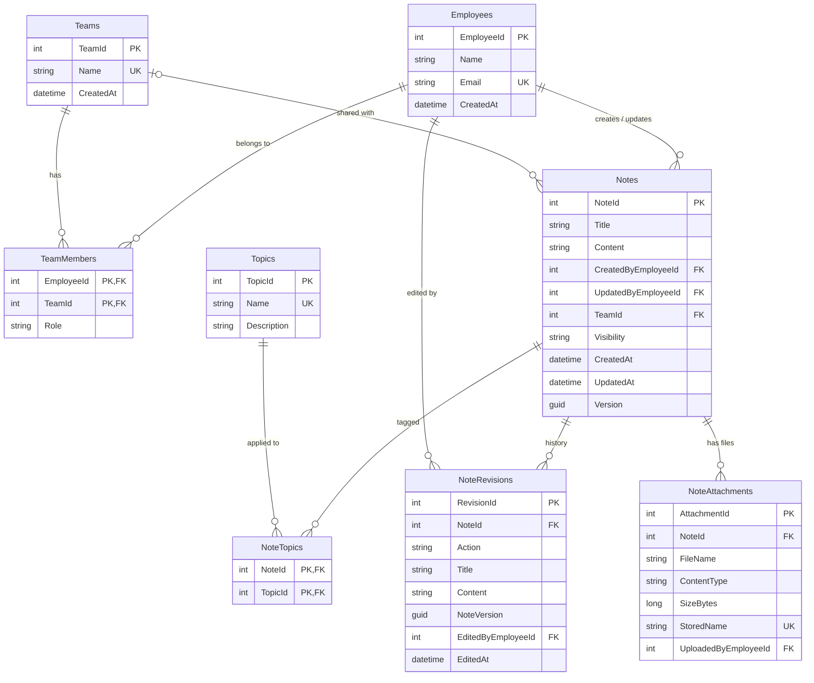

# teamNotes (Shared Team Notes Service)

A small note-taking service shared among teams in an organization, with a REST API and a simple browser UI.

## Project overview

Employees capture, organize, search and edit notes. Each note is **Private** (only its creator), **Team** (members of one team) or **All** (every employee). Only the creator can delete a note. Concurrent edits are detected so one person cannot silently overwrite another's changes.

**Scope:** notes, teams (with membership), employees, topics (tags), visibility rules, filtering/search, optimistic concurrency, a demo browser client and integration tests. **Out of scope:** production authentication, roles, note history, pagination, attachments, real-time collaboration.

> **Sign-in:** local email + password. Passwords are hashed with PBKDF2-SHA256 and the session is an HttpOnly, SameSite=Strict cookie. The seeded accounts and the demo quick-switch described below exist **only in Development** and use made-up credentials. Run behind HTTPS in any real deployment.

## Technology stack

| Concern | Choice | Why |
|---|---|---|
| Language / framework | C#, ASP.NET Core Web API, .NET 10 | Controllers + DI + static file hosting in one process |
| Database | SQLite (file) | Zero setup, relational, enough for a small team service |
| ORM | Entity Framework Core 10 with migrations | Typed model, migrations, built-in concurrency-token support |
| Frontend | HTML, CSS, vanilla JavaScript | No build step; served by the same app |
| Tests | xUnit, `WebApplicationFactory`, SQLite in-memory | Tests drive the real HTTP API and a real relational engine |

## Architecture

A **modular monolith**: one ASP.NET Core process hosts the REST API and the static HTML client. The browser UI only talks to the API over HTTP/JSON; it never touches the database.

```
Browser (wwwroot: HTML/CSS/JS)
        │  HTTP + JSON, session cookie
        ▼
ASP.NET Core app (SharedNotes.Api)
  ├─ Middleware   exception → ProblemDetails; cookie → current employee
  ├─ Controllers  HTTP concerns only (routing, status codes)
  ├─ Services     business rules + authorization (NoteService, TeamService, …)
  ├─ DTOs         request/response contracts (entities are never exposed)
  └─ Data         EF Core DbContext, configurations, migrations, seed data
        ▼
SQLite file (sharednotes.db)
```

```
src/SharedNotes.Api/   Controllers/ Services/ Models/ DTOs/ Data/(Configurations, Migrations) Identity/ Middleware/ wwwroot/
tests/SharedNotes.Tests/
```

## Database schema

- **Employees** – `EmployeeId`, `Name`, `Email` (unique, case-insensitive), `PasswordHash` (PBKDF2, never returned by the API), `Role` (`Employee` or `Admin`), `CreatedAt`.
- **Teams** – `TeamId`, `Name` (unique, case-insensitive), `CreatedAt`.
- **TeamMembers** – join table, composite key (`EmployeeId`, `TeamId`), optional `Role`. An employee may be in many teams.
- **Notes** – `NoteId`, `Title`, `Content`, `CreatedByEmployeeId`, `UpdatedByEmployeeId`, `TeamId?`, `Visibility` (`Private`/`Team`/`All`), `CreatedAt`, `UpdatedAt`, `Version` (GUID concurrency token). A CHECK constraint enforces "`TeamId` is set exactly when `Visibility = 'Team'`".
- **Topics** – `TopicId`, `Name` (unique, case-insensitive), `Description?`.
- **NoteTopics** – join table, composite key (`NoteId`, `TopicId`).
- **NoteRevisions** – one immutable snapshot per create/update (title, content, visibility, team name, topic names, the note `Version` it produced, who and when). Cascade-deleted with the note.
- **NoteAttachments** – metadata for files attached to a note (sanitized display name, allow-listed content type, size, random on-disk name, uploader). The bytes are stored on disk, not in SQLite. Cascade-deleted with the note (the files are removed too).

Delete behaviour: deleting a note, topic, team or employee **cascades only to join rows** (`NoteTopics`, `TeamMembers`). Notes reference employees and teams with `RESTRICT`, so nobody can be deleted out from under a note. (There are no endpoints to delete employees or teams.)



## Running locally

**Requirements:** the [.NET 10 SDK](https://dotnet.microsoft.com/download) (`dotnet --version` should print `10.x`). Nothing else.

```bash
git clone https://github.com/SamuelSwanson/teamNotes.git
cd teamNotes
dotnet restore
dotnet run --project src/SharedNotes.Api --launch-profile http
```

Then open **http://localhost:5115** in a browser.

**Database:** there is nothing to set up. On startup the app applies EF Core migrations, which creates `src/SharedNotes.Api/sharednotes.db` and inserts the demo data (4 employees, 2 teams, 3 topics, 4 notes). To reset, stop the app and delete that file. To apply migrations manually: `dotnet tool install -g dotnet-ef` then `dotnet ef database update --project src/SharedNotes.Api`.

**Demo data:**

| Employee | Teams |
|---|---|
| 1 Alice Chen (admin; leads Engineering) | Engineering, Marketing (two teams) |
| 2 Bob Martinez | Engineering |
| 3 Carol Singh (leads Marketing) | Marketing |
| 4 Dave Okafor | none |

**Sign in (Development only, made-up credentials):** every demo account has the password `Password123!` (set in `appsettings.Development.json`).

| Email | Role | Name |
|---|---|---|
| `admin@notes.com` | Admin | Alice Chen |
| `bob@notes.com` | Employee | Bob Martinez |
| `carol@notes.com` | Employee | Carol Singh |
| `dave@notes.com` | Employee | Dave Okafor |

The login page lists these, and a **Demo switch** dropdown in the header signs you in as another seeded employee without logging out (handy for seeing visibility rules). That switch is a password-less login controlled by `Demo:QuickSwitch`, which is on only in `appsettings.Development.json`; it returns 404 otherwise. To see a conflict, open the same note in two browser tabs as different employees, save in one, then save in the other.

Outside Development no passwords are seeded: set `Demo:SeedPasswords=true` and `Demo:Password` yourself (not for real use), or create employees through `POST /api/employees` as an admin.

**Tests:**

```bash
dotnet test
```

## API reference

All `/api/*` endpoints require a signed-in session cookie (missing or invalid → `401`), except `POST /api/auth/login`, `POST /api/auth/logout` and the Development-only `/api/demo/*` helpers. Errors use RFC 7807 `ProblemDetails` (`application/problem+json`). Enums are strings.


### Authentication and roles

| Endpoint | Behaviour |
|---|---|
| `POST /api/auth/login` `{email, password}` | `200` with the employee and a session cookie; `401` for any wrong email or password (same message either way); `429` after 10 attempts per minute per client address. |
| `POST /api/auth/logout` | `204`, clears the cookie. |
| `GET /api/auth/me` | The signed-in employee including `role`. |
| `POST /api/auth/change-password` `{currentPassword, newPassword}` | `204`; `400` if the current password is wrong or the new one is shorter than 8 characters. |
| `GET /api/demo/info`, `POST /api/demo/login/{employeeId}` | Development quick-switch; `404` unless `Demo:QuickSwitch` is true. |

**Roles:** an `Admin` can create employees (with an initial password and role), edit or delete topics, and manage any team's members. A team **lead** (a member whose `Role` is `Lead`; a team's creator becomes its lead) can add and remove that team's members. Everyone else can write notes they have access to and create topics and teams. Reading and editing notes follows only the visibility rules, so admins get no special access to other people's private notes.

**Test-only identity header:** integration tests set `Auth:AllowHeaderIdentity=true` so they can act as any employee with `X-Employee-Id: <id>` instead of logging in. It is off by default, is not in any shipped appsettings file, and must never be enabled in production. The examples below show it for brevity. Against the real app, log in first and send the cookie:

```bash
curl -c cookies.txt -H "Content-Type: application/json" -d '{"email":"admin@notes.com","password":"Password123!"}' http://localhost:5115/api/auth/login
curl -b cookies.txt http://localhost:5115/api/notes
```

**Status codes:** `200` OK, `201` Created, `204` No Content, `400` validation / bad reference, `401` identity, `403` not allowed, `404` not found, `409` conflict, `500` unexpected.

### Notes

| Method & path | Notes |
|---|---|
| `GET /api/notes` | Notes the current employee can access. Query: `teamId`, `topicId`, `createdBy`, `visibility`, `search`. Without `search`: newest update first. With `search`: full-text results, best match first (see below). |
| `GET /api/notes` paging | `page` (default 1) and `pageSize` (default 50, max 100). The body stays a plain array; the response headers `X-Total-Count` (all matches), `X-Page` and `X-Page-Size` describe the page. A page past the end returns `[]`. Invalid values return `400`. Only the notes list is paged. Search results are paged too, over at most the 1000 best matches. |
| `GET /api/notes/{id}` | `200`; `403` if no access; `404`. |
| `POST /api/notes` | Body: `title`, `content`, `visibility`, `teamId` (required for `Team`, must be null otherwise), `topicIds?`. `201`; `400` bad input or unknown topic/team; `403` if not a member of `teamId`. Creator/updater come from the header, never the body. |
| `PUT /api/notes/{id}` | Same body plus **`expectedVersion`** (required). `200` with the new `version`; `403` no access (or non-creator changing visibility/team); `409` if `expectedVersion` is stale. |
| `DELETE /api/notes/{id}` | Creator only. `204`; `403`; `404`. |
| `GET /api/notes/{id}/history` | Every saved state of the note, newest first (`action`, `title`, `content`, `visibility`, `teamName`, `topics`, `noteVersion`, editor, `editedAt`). Same access rule as reading the note: `403`/`404` accordingly. |
| `GET /api/notes/{id}/editors` | Other employees currently editing the note (`employeeId`, `name`). Same access rule as reading the note. |
| `PUT /api/notes/{id}/editing` | Heartbeat: marks you as editing the note. Repeat every ~20s; it expires after ~45s. `204`. |
| `DELETE /api/notes/{id}/editing` | Marks you as no longer editing. `204`. |

Note responses include `version`, `canDelete`, `topics`, creator/updater ids and names, `createdAt`, `updatedAt`.

### Teams, employees, topics

| Endpoint | Behaviour |
|---|---|
| `GET /api/teams`, `GET /api/teams/{id}` | Teams with their members. |
| `POST /api/teams` `{name}` | `201`; creator becomes the first member; `409` duplicate name. |
| `POST /api/teams/{id}/members` `{employeeId, role?}` | Admin or team lead (`403` otherwise). `201`; `409` already a member; `400` unknown employee; `404` unknown team. |
| `DELETE /api/teams/{id}/members/{employeeId}` | Admin or team lead. `204`; `404` if not a member. |
| `GET /api/employees`, `GET /api/employees/{id}` | Employees with their teams. |
| `POST /api/employees` `{name, email, password, role?}` | Admin only (`403` otherwise). `201`; `409` duplicate email; `400` invalid email or password under 8 characters. |
| `GET/POST /api/topics`, `GET/PUT/DELETE /api/topics/{id}` | `409` on duplicate name. PUT and DELETE are admin only. Deleting a topic removes only its links to notes; the notes remain. |

### Example requests

```http
GET /api/notes?search=sprint&teamId=1 HTTP/1.1
X-Employee-Id: 1
```

```http
POST /api/notes HTTP/1.1
X-Employee-Id: 1
Content-Type: application/json

{ "title": "Retro", "content": "What went well…", "visibility": "Team", "teamId": 1, "topicIds": [2] }
```

```http
PUT /api/notes/5 HTTP/1.1
X-Employee-Id: 2
Content-Type: application/json

{ "title": "Retro", "content": "Edited", "visibility": "Team", "teamId": 1, "topicIds": [2],
  "expectedVersion": "3f0c2b7e-9a41-4d6e-b0a8-1c2d3e4f5a6b" }
```

A stale `expectedVersion` returns `409 Conflict`; re-`GET` the note, reapply your change to the fresh copy, and retry with its new `version`.

### Search

`search` uses an SQLite **FTS5** full-text index over note titles and content, created by a migration and kept up to date by database triggers (so it stays correct even for writes outside the API):

- **Words, not substrings:** matching is per word, case-insensitive and accent-insensitive (`cafe` finds `Café`), with **stemming** (`plans` finds `planning`) and **prefix** matching (`sprin` finds `sprint`). All words must match. A word fragment from the *middle* of a word (`ning`) does not match.
- **Ranking:** best match first, with title matches weighted above content matches. At most the 1000 best matches are considered.
- **Safe input:** the text is reduced to quoted word terms, so characters such as `"`, `*`, `OR`, `NEAR` or `:` are never interpreted as search operators and cannot cause errors.
- **No leaks:** the index only yields candidate ids; they are intersected with the notes the employee may read before anything is returned.
- **Caveat for developers:** if a future migration makes EF rebuild the `Notes` table, SQLite drops its triggers; that migration must recreate them (noted in the `AddFullTextSearch` migration).

### Attachments

| Endpoint | Behaviour |
|---|---|
| `POST /api/notes/{id}/attachments` | `multipart/form-data` with one file in the field `file`. `201` with the attachment; `400` for a disallowed type, content that does not match the extension, an empty file, more than 5 MB, or more than 10 files on the note; `403`/`404` per the note's access rules. |
| `GET /api/notes/{id}/attachments` | Attachment metadata for the note. |
| `GET /api/notes/{id}/attachments/{attachmentId}` | Downloads the file. |
| `DELETE /api/notes/{id}/attachments/{attachmentId}` | The uploader or the note's creator. `204`; others get `403`. |

Notes also include an `attachments` array. Anyone who can read a note can download its files, and anyone who can edit it can attach files (these are the same people). Files are stored in `src/SharedNotes.Api/App_Data/attachments` (git-ignored); change the location with the `Attachments:Path` setting, and back it up together with the SQLite file.

How uploads are kept safe:

- **Allow-list of types** (`.pdf .png .jpg .jpeg .gif .txt .md .csv .docx .xlsx .pptx`). HTML, SVG, scripts and executables are refused. The stored content type comes from this list, never from the client.
- **Content check:** binary types must start with the right file signature for their extension; text types must not contain NUL bytes. This blocks the obvious "HTML renamed to `.png`" trick but is not a virus scan.
- **No path tricks:** files are saved under random 32-character names; the original name is sanitized, kept only as metadata, and never used as a path.
- **Forced download:** responses use `Content-Disposition: attachment` and `X-Content-Type-Options: nosniff`, so uploaded content is never rendered inside the app's origin. The whole app also sends a `Content-Security-Policy` (`default-src 'self'`), `X-Frame-Options: DENY` and `Referrer-Policy: no-referrer`.
- **Not part of the concurrency token:** adding or removing a file does not change the note's `version`, so it never causes someone else's text edit to be rejected, and it is not recorded in note history.

Limits: no virus scanning, no image thumbnails or previews, one file per request, and files live on the application server's disk (a multi-server deployment would need shared storage).

### Live updates and editing presence

`GET /api/events` is a [Server-Sent Events](https://developer.mozilla.org/docs/Web/API/Server-sent_events) stream (sign-in required) used by the browser UI. It emits `note-changed`, `note-deleted` and `editing` events with `noteId`, `actorId`, `actorName` and, where relevant, `version` or `active`.

- **No content leaks:** events carry no note content, and each one is delivered only to employees who may read that note (Private: its creator, Team: current team members, All: everyone). Clients re-fetch through the normal authorized API.
- **Concurrency is unchanged:** a live notice that someone else saved is advisory. The `expectedVersion` check on `PUT` is still what prevents lost updates.
- **UI behaviour:** the list refreshes itself when events arrive; an open editor shows "X is also editing" and "X saved a newer version" notices, and the user chooses when to reload.
- **Limits:** the broadcaster and presence tracker live in process memory. That is right for this single-process monolith. Running several instances would need a shared backplane (for example Redis pub/sub). A client that misses events (slow connection, dropped stream) catches up on its next list refresh or reconnect. `Presence:TtlSeconds` (default 45) and `Presence:SweepSeconds` (default 10) tune presence expiry.

### Behaviour decisions worth knowing

- **403 vs 404:** a note that exists but is not visible to you returns `403` (predictable, as the spec's status list suggests). This reveals that the id exists; returning `404` instead would hide it.
- **Editing = reading:** anyone who can read a note can edit it. Only the creator can delete it or change its visibility/team.
- **Directory data:** any signed-in employee can create teams and topics; roles above govern the rest.
- **Audit and history:** `CreatedAt/By` and `UpdatedAt/By` stay on `Notes` for quick display. In addition, every create and update writes an immutable snapshot to `NoteRevisions` in the same transaction as the note change, so a rejected (409) update leaves no history. History is readable by anyone who can read the note, and is deleted with the note. Restoring an old revision is not implemented; copy the content from the History view.

## Design decisions

### Decision 1: Modular monolith vs. microservices

- **Problem:** how to structure a small notes service with an API and a UI.
- **Alternatives:** microservices (e.g. separate notes, identity, and directory services); a modular monolith.
- **Selected:** a modular monolith, with controllers → services → EF Core kept separate inside one deployable.
- **Why:** the data is small and tightly related (every note query joins teams and membership), so splitting it would turn simple joins into network calls and distributed consistency problems. One process means one deployment, one database, in-process tests and trivial local setup. Layering keeps the code organized and splittable later.
- **Tradeoffs:** one deployable scales and fails as a unit, and a bug in one area can take down all of them. Teams cannot deploy modules independently. If that ever matters, the service boundaries (`NoteService`, `TeamService`, …) are natural seams.

### Decision 2: Relational database and schema design

- **Problem:** store notes with sharing rules, teams and tags.
- **Alternatives:** document store; SQL Server/PostgreSQL; SQLite.
- **Selected:** SQLite with EF Core, normalized schema.
- **Why:** the data is relational (employees↔teams, notes↔topics, notes→employees) and benefits from foreign keys and unique constraints. SQLite needs no server, so anyone can clone and run. Employees and teams are many-to-many (`TeamMembers`) because people work across teams. Topics are their own entity so names are unique and renaming one updates every note; `NoteTopics` is the many-to-many join. Visibility is a single column (`Private`/`Team`/`All`) plus a nullable `TeamId`, with a CHECK constraint so the two cannot disagree. Access is one query predicate shared by listing and single-note checks.
- **Tradeoffs:** SQLite allows a single writer at a time and has no `rowversion`, so concurrency uses an application token (see below). Search uses an SQLite FTS5 index, which ties it to SQLite-specific SQL. Moving to PostgreSQL later is mostly a provider change.

### Decision 3: Optimistic concurrency

- **Problem:** two employees open the same note, both edit, and the last save silently erases the first (a lost update).
- **Alternatives:** pessimistic locks (blocks people, needs lock cleanup); compare `UpdatedAt`; a version token.
- **Why not `UpdatedAt`:** timestamps can collide at the clock's resolution or be skewed between servers, and a check done as a separate read before the write leaves a gap in which another request can slip in.
- **Selected:** each note has a GUID `Version` configured as an EF Core concurrency token. Clients receive it on read and send it back as `expectedVersion`. On update the server sets the token's original value to `expectedVersion` and assigns a new GUID. EF then issues `UPDATE … WHERE NoteId = @id AND Version = @expectedVersion` as **one atomic statement**. If another request changed the row first, zero rows match, EF throws `DbUpdateConcurrencyException`, and the transaction (including topic link changes) rolls back. So the check does not rely on an earlier GET, and of N simultaneous updates from the same version, exactly one succeeds.
- **Why 409:** the request was valid but conflicts with the current state of the resource.
- **Limitations:** it detects conflicts but does not merge them; the user must reload and reapply. Any unique/foreign-key violation during an update is also reported as `409`. It protects notes only, not other resources. It is not real-time: users find out when they save.

## Future improvements and lessons learned

Not implemented, but worth doing with more time:

- Further hardening of sign-in: account lockout, password reset by email, multi-factor authentication, single sign-on.
- Collaborative co-editing (shared cursors, merging of simultaneous edits). Live updates and "also editing" notices exist, but conflicts are still resolved by reloading.
- Notifications.
- Frontend improvements (accessibility review, richer editing, a proper conflict-resolution view showing both versions).
- A different database if write load grows, and reconsidering the monolith if modules need independent deployment.

Notes on scale: pagination uses offset/limit, which is simple and fine at this size; for very large histories keyset pagination (cursor on `UpdatedAt, NoteId`) would be steadier under concurrent writes. Other collections (teams, topics, employees) are small and not paged.

Lessons: choosing the concurrency token early shaped the API (`expectedVersion`, `409`); keeping the access rule in one query predicate made visibility easy to test; and testing against a real relational engine (SQLite in-memory) caught behaviour such as constraints and cascades that the EF InMemory provider would hide.

## Testing notes

`dotnet test` runs integration tests through `WebApplicationFactory`. Each test gets its own shared-cache SQLite in-memory database (a "keeper" connection stays open for its lifetime), migrated and seeded like the real one. Coverage: notes CRUD, search, filters, multiple topics; Private/Team/All visibility; creator-only delete; identity (401); relationships and duplicates; topic deletion; and concurrency including parallel updates from the same version.
